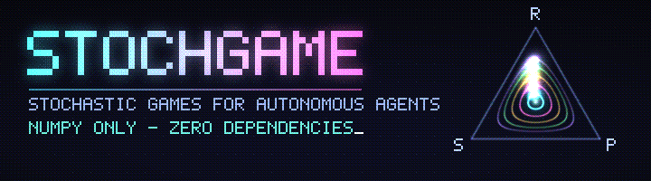

<p align="center">
  
</p>

<p align="center">
  <a href="https://github.com/vantacorehq/stochgame/actions/workflows/ci.yml"></a>
  
  
  <a href="LICENSE"></a>
</p>

<p align="center">
  <b>English</b> · <a href="README.ru.md">Русский</a>
</p>

# stochgame

Stochastic games and game-theory simulation engine for autonomous AI agents.
**Single file, one dependency: `numpy`.**

## Quick start

```bash
pip install numpy
git clone https://github.com/vantacorehq/stochgame.git
cd stochgame
python stochgame.py selftest   # 8 sanity checks
python stochgame.py demo       # guided tour of everything (~20 s)
```

Or just copy `stochgame.py` into your project. Nothing else is needed.

## What's inside

| Block            | Contents                                                                                                             |
|------------------|----------------------------------------------------------------------------------------------------------------------|
| Solvers          | exact LP for zero-sum games (simplex), all Nash equilibria of a bimatrix game (support enumeration), `nash_gap`      |
| `StochasticGame` | N players, S states, `P[s,a0..aN,s']`, `R[s,a0..aN,i]`, terminal states                                             |
| Planning         | Shapley value iteration (`shapley`) for 2-player zero-sum games                                                      |
| Agents           | `RandomAgent`, `Always`, `QLearner`, `MinimaxQ`, `RegretMatcher`, `TitForTat`, `GrimTrigger`, `Pavlov`              |
| Simulation       | `play`, `tournament` (round robin), `replicator` (RK4)                                                               |
| Games            | prisoner's dilemma, stag hunt, chicken, rock-paper-scissors, matching pennies, repeated games with memory, `commons` (tragedy of the commons), `random_game` |

## Examples

### Two Q-learners in the tragedy of the commons

```python
import stochgame as sg

g = sg.commons()                                   # stochastic game with a shared resource
agents = [sg.QLearner(), sg.QLearner()]
res = sg.play(g, agents, episodes=300, horizon=50)
print(res.returns[-30:].mean(0), res.freq[-30:, :, 0].mean())   # returns, share of the "conserve" action
```

### Tournament in the repeated prisoner's dilemma

```python
names, M = sg.tournament(
    sg.prisoners_dilemma(),
    {"TFT": sg.TitForTat, "ALLD": lambda: sg.Always(1), "Pavlov": sg.Pavlov},
)
print(sg.format_matrix(names, M))
```

### Exact solution of a zero-sum stochastic game

```python
V, policies = sg.shapley(sg.random_game(4, 3, 3, seed=7))
```

### Nash equilibria of a bimatrix game

```python
for x, y in sg.nash_equilibria(sg.CHICKEN, sg.CHICKEN.T):
    print(x.round(2), y.round(2))
```

### Write your own agent

Subclass `Agent`, implement `act(s)` and, optionally, `observe(s, acts, r, s2, done)`:

```python
class Sulky(sg.Agent):
    """Cooperates until the opponent defects twice in a row."""
    name = "Sulky"

    def reset(self): self.bad = 0
    def new_episode(self): self.bad = 0
    def act(self, s): return 1 if self.bad >= 2 else 0
    def observe(self, s, acts, r, s2, done):
        self.bad = self.bad + 1 if acts[1 - self.me] == 1 else 0

names, M = sg.tournament(sg.prisoners_dilemma(), {"TFT": sg.TitForTat, "Sulky": Sulky})
```

To define your own game, pass the tensors `P` and `R` to `StochasticGame`.

## Repository layout

```
stochgame.py          # the whole engine (single file)
banner.gif            # README banner
tests/                # pytest suite
.github/workflows/    # CI
```

## Development

```bash
pip install numpy pytest
pytest -q
```

## References

- Shapley (1953), *Stochastic games*
- Littman (1994), *Markov games as a framework for multi-agent reinforcement learning*
- Axelrod (1984), *The Evolution of Cooperation*

## License

[MIT](LICENSE)
